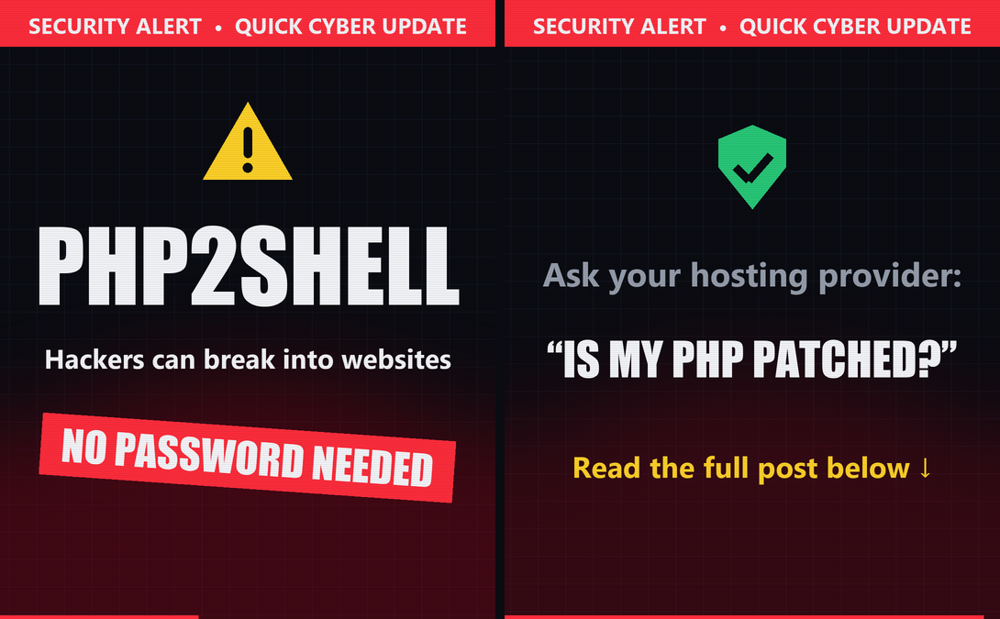

# PHP2Shell: Quick Cyber Update 🚨

A 5-second awareness clip about **PHP2Shell**, a recently reported set of PHP vulnerabilities that could let attackers break into vulnerable website servers **without needing a password**.

PHP powers millions of websites, including those built with **WordPress**, so small businesses, bloggers and online stores should pay attention.



## The videos

| File | Size | Best for |
|---|---|---|
| [`php2shell_facebook_4x5.mp4`](php2shell_facebook_4x5.mp4) | 1080×1350 (4:5) | Facebook feed |
📣 **See the post:** [Facebook](https://www.facebook.com/your-post-link)

| [`php2shell_linkedin_1x1.mp4`](php2shell_linkedin_1x1.mp4) | 1080×1080 (1:1) | LinkedIn feed |

Both clips are 5 seconds long and silent, because most people scroll with the sound off.

**Scene 1 (0–2.4s):** ⚠️ **PHP2SHELL**: "Hackers can break into websites" → **NO PASSWORD NEEDED**
**Scene 2 (2.4–5s):** 🛡️ "Ask your hosting provider: **Is my PHP patched?**" → "Read the full post below ↓"

## What to do (post text)

Post the video with this guidance as the caption:

1. 💻 **Keep your website updated.** Run the latest versions of WordPress, plugins and themes.
2. ⚙️ **Check your PHP version.** Ask your hosting provider whether your server has the latest PHP security patches. *This is the most important step.*
3. 💾 **Enable automatic updates** wherever possible.
4. 🔒 **Use strong passwords and MFA** on admin accounts. MFA helps, but it can't fix a vulnerable server.
5. 💾 **Back up your website** regularly.

> The one question to ask your host:
> **"Is my website protected against the recent PHP security vulnerabilities?"**

## Rebuild or edit the videos

Requires Python 3 on Windows (it uses the Impact and Segoe UI fonts from `C:\Windows\Fonts`).

```bash
pip install -r requirements.txt
python make_snip.py
```

This writes both `.mp4` files into the current folder. To change the wording, timing or colors, edit the text and the `SCENES` timings in `make_snip.py`. `imageio-ffmpeg` includes its own ffmpeg, so you don't need to install it separately.
